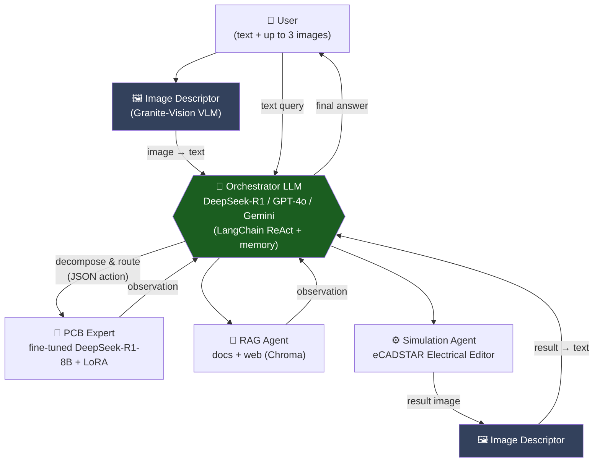
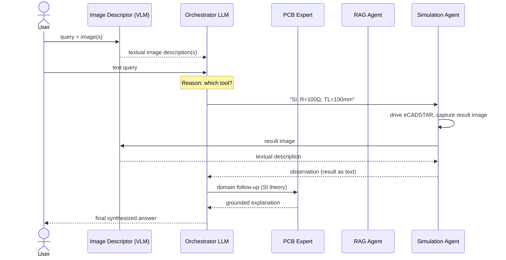
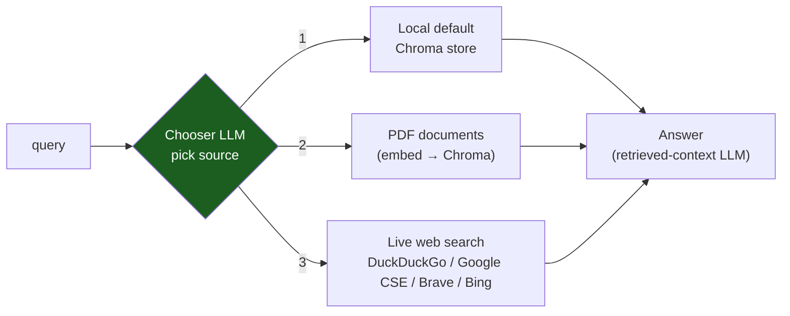
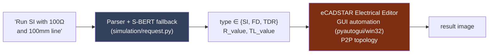
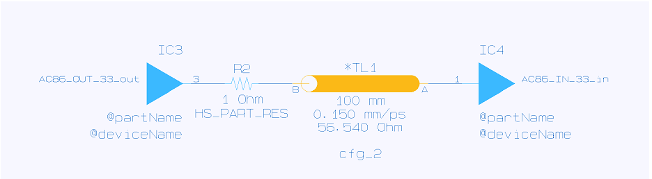
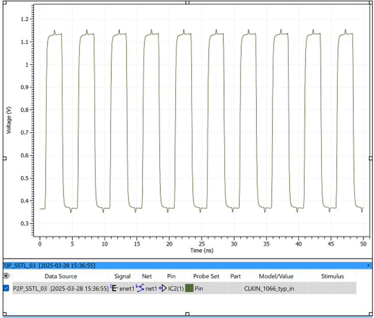
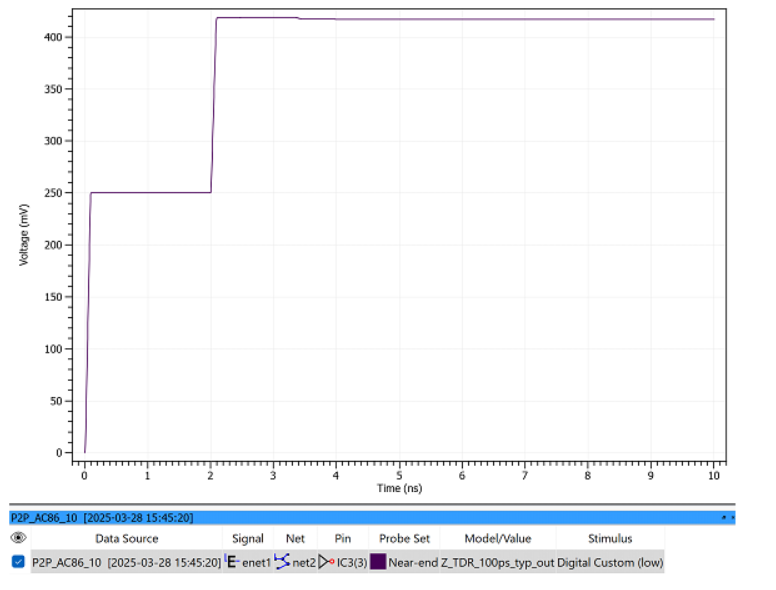
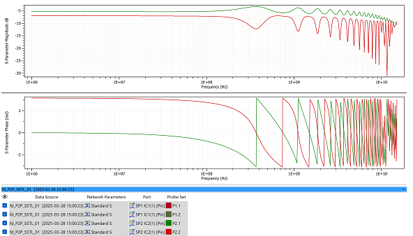

<div align="center">

# A Multi-Agent LLM Assistant for PCB Design CAD (eCADSTAR)

*An orchestrated, multimodal, tool-using chatbot that helps beginners learn and operate a
Signal-Integrity EDA workflow — answering domain questions, running live simulations, and
interpreting circuit & result images.*

</div>

[](https://github.com/kovarthanmuthusamy/pcb-cad-llm-assistant/actions/workflows/ci.yml)

---

## Abstract

Electronic Design Automation (EDA) tools such as **eCADSTAR** are powerful but steep to learn: a
newcomer must simultaneously understand Signal-Integrity (SI) theory, the CAD UI, and how to read
simulation outputs. This project develops a **multi-agent Large Language Model (LLM) assistant** that
lowers that barrier. A central **orchestrator LLM** decomposes a user's request and routes it to a
set of specialized tools: a **domain-fine-tuned PCB expert**, a **Retrieval-Augmented Generation
(RAG)** agent over internal documents and the live web, a **simulation agent** that drives the
eCADSTAR Electrical Editor and returns results, and a **vision agent** that turns circuit and
simulation **images into text** so the (text-only) orchestrator can reason over them. The system is
**multimodal** (accepts text + images), **model-agnostic** (the orchestrator can be a local DeepSeek-R1
model via Ollama, OpenAI GPT-4o, or Google Gemini), and grounded in the SI sub-domain of EDA through
LoRA fine-tuning.

> **Context.** Group research project. Built with vision-language and reasoning models available in
> 2023–2024 that were strong at both agentic tool-use and image understanding.

### Contribution and ownership

Kovarthanam Muthusamy designed the LangChain/ReAct orchestration, implemented the RAG sub-agent,
connected the natural-language parameter extractor to eCADSTAR automation, built the FastAPI
backend behind the team's user interface, and integrated the project components into the assistant
workflow. The vision component, including the fine-tuning of the vision-language model and the VLM
experiments in `research/vlm/`, was developed by a project colleague and integrated into this
system; it is not presented as an individually authored model. The team coordinated through Git;
colleagues built a React user interface intended for use alongside the eCADSTAR PCB editor. The
FastAPI backend, that interface and the Docker setup used for reproducible environments are not
part of this public showcase.

This public repository is a reviewed research showcase. Private corpora, model adapters,
checkpoints, Chroma databases, and raw eCADSTAR project/result files are deliberately excluded.

---

## Table of Contents

1. [Motivation](#1-motivation)
2. [System Architecture](#2-system-architecture)
3. [Query Lifecycle](#3-query-lifecycle)
4. [Components](#4-components)
   - [4.1 Orchestrator](#41-orchestrator-model-agnostic)
   - [4.2 PCB Expert (fine-tuned)](#42-pcb-expert-fine-tuned-sub-agent)
   - [4.3 RAG Agent](#43-rag-agent-documents--web)
   - [4.4 Simulation Agent](#44-simulation-agent-ecadstar)
   - [4.5 Image Descriptor (vision)](#45-image-descriptor-vision-agent)
5. [Repository Structure](#5-repository-structure)
6. [Setup & Usage](#6-setup--usage)
7. [Security Notes](#7-security-notes)
8. [Limitations & Future Work](#8-limitations--future-work)
9. [Verification & Evidence](#9-verification--evidence)

---

## 1. Motivation

A beginner using a Signal-Integrity CAD tool repeatedly hits three walls:

1. **Knowledge** — "What is a TDR analysis? Why does my net ring?"
2. **Operation** — "How do I actually run this simulation with these parameters?"
3. **Interpretation** — "What does this result waveform / circuit screenshot mean?"

A single LLM cannot reliably do all three: it lacks tool access, up-to-date/document-grounded facts,
and (for a text model) the ability to see images. This project addresses each wall with a dedicated
agent, coordinated by an orchestrator — a classic **planner + specialized-tools** architecture.

---

## 2. System Architecture



The orchestrator follows a **ReAct** loop (Reason → Act → Observe), emitting a structured JSON
`{action, action_input}` per step (LangChain `STRUCTURED_CHAT_ZERO_SHOT_REACT_DESCRIPTION`), and
keeps short-term context via `ConversationBufferMemory`. Because every tool returns **text**, even
inherently visual results (simulation plots) are first passed through the vision agent — making the
whole pipeline reason in a single textual space.

---

## 3. Query Lifecycle



---

## 4. Components

### 4.1 Orchestrator (model-agnostic)

One agent, one tool set and one prompt; the back-end is chosen with `--provider`:

| Command | Default orchestrator model | Provider |
| ------- | -------------------------- | -------- |
| `python -m pcb_assistant --provider ollama` | `deepseek-r1:70b` (or `:32b`) | **Local** via Ollama |
| `python -m pcb_assistant --provider openai` | `gpt-4o` | OpenAI |
| `python -m pcb_assistant --provider google` | `gemini-1.5-pro` (check that the model is still served) | Google |

Model names, temperature and the other tunables are environment variables (see
[`.env.example`](.env.example) and `src/pcb_assistant/config.py`). The small differences between
providers (iteration limit, one extra prompt sentence, whether the last message is repeated in the
input) are explicit profiles in `llm.py`.

Tools are registered as LangChain `StructuredTool`s with Pydantic input schemas
(`src/pcb_assistant/tools.py`). The orchestrator emits tool input in several shapes; one function
(`unwrap_tool_input`) normalises them, and the tools reuse the tested parsing in `contracts.py`.
A system instruction constrains the agent to **one action at a time**, and post-processing strips
the model's `<think>` traces and trailing JSON before display.

### 4.2 PCB Expert (fine-tuned sub-agent)

`src/pcb_assistant/experts/pcb_expert.py` — a **DeepSeek-R1-Distill-Llama-8B** base model with a
**LoRA adapter** fine-tuned on domain question–answer pairs in the **Signal-Integrity area of EDA**.
It answers PCB design, manufacturing, and noise questions as concise paragraphs, and is the
*primary* tool for any PCB-related query. The model and adapter are loaded on first use and then
kept in memory. A Llama-3-8B + LoRA variant was also trained (see
[docs/EVALUATION.md](docs/EVALUATION.md)); only the DeepSeek-based expert is wired in here.

### 4.3 RAG Agent (documents + web)

`src/pcb_assistant/rag/` — a **router-based** retrieval agent. A lightweight LLM router
(`router.py`) looks at the file names of the available local corpora and at the query, then selects
a source:



Retrieved passages are embedded and stored in a **Chroma** vector database, then a generator model
(`deepseek-r1:32b`) answers from the retrieved context. Multiple search back-ends are supported
(`web_search.py`). This is the fallback when the fine-tuned expert lacks coverage and provides
**document- and web-grounded** facts.

The router can only answer 1, 2 or 3 and anything else falls back to the web, so it can never
trigger a delete action. A small local Flask page (`python -m pcb_assistant.rag.webui.app`) manages
uploads and queries; it has no authentication and is meant for local use only.

### 4.4 Simulation Agent (eCADSTAR)

Turns natural language into an actual CAD simulation:



- **Parameter extraction** (`simulation/request.py`, `contracts.py`): explicit **SI** (Signal
  Integrity), **FD** (Frequency Domain) or **TDR** (Time-Domain Reflectometry) terms and the
  resistor (Ω) and transmission-line length (mm) values are parsed deterministically. Only when no
  analysis is named does a Sentence-BERT model (`all-MiniLM-L6-v2`, `simulation/semantic.py`)
  suggest one, and a match below a similarity threshold is rejected so the agent can ask the user
  instead of guessing.
- **Execution** (`simulation/ecadstar.py`): patches the SIDF/circuit file with those values and
  drives the eCADSTAR Electrical Editor via GUI automation on the default **P2P** topology, capturing
  the result image. The fixed waits of the GUI automation are configurable
  (`ECADSTAR_OPEN_WAIT_S`, `ECADSTAR_RUN_WAIT_S`).
- The image is then described by the vision agent and returned to the orchestrator as text.



*Default P2P topology. The agent sets the series resistor (R2) and line length (TL1) from the user's request.*

### 4.5 Image Descriptor (vision agent)

`src/pcb_assistant/vision/granite.py` — a **fine-tuned IBM Granite-Vision-3.2-2B** vision-language
model (4-bit NF4 quantized, LoRA adapter set with `PCB_VISION_ADAPTER_PATH`), prompted to describe
PCB-domain images: circuit topologies (star / P2P) and simulation result plots. It serves **two**
roles: (1) converting user-attached images into text at input, and (2) converting simulation
**output** images into text. The model is loaded on first use. The fine-tuning and the alternative
VLM back-ends that were compared (**LLaVA-1.6-Mistral**, **Qwen2.5-VL-7B**, **SmolVLM-500M**) are a
project colleague's work; their notebooks and scripts are kept unchanged in `research/vlm/`.

---

## 5. Repository Structure

```text
pcb-cad-llm-assistant/
├── main.py                         launcher: python main.py --provider ollama|openai|google
├── src/pcb_assistant/
│   ├── cli.py                      command line and chat loop
│   ├── agent.py                    ReAct agent: tools, memory, system instruction
│   ├── llm.py                      orchestrator back-ends (ollama / openai / google profiles)
│   ├── tools.py                    Simulation, PCB Expert and RAG tools
│   ├── config.py                   all settings, read from the environment / .env
│   ├── contracts.py                portable, model-free tool-input contracts
│   ├── text.py                     cleaning of model output
│   ├── simulation/                 request parsing, S-BERT fallback, eCADSTAR GUI adapter
│   ├── experts/pcb_expert.py       fine-tuned SI/EDA expert (DeepSeek-R1-8B + LoRA)
│   ├── vision/granite.py           image -> text (Granite-Vision)
│   └── rag/                        router, document and web retrieval, search back-ends, web UI
├── tests/                          unit tests with fakes: no model, GPU, credentials or eCADSTAR
├── research/vlm/                   VLM fine-tuning notebooks and alternative back-ends (teammate)
├── hf_ollama/hf_join.py            merge a LoRA adapter for Ollama export
├── docs/
│   ├── EVALUATION.md               implemented evidence and benchmark plan
│   └── images/                     eCADSTAR topology and result examples
├── .github/workflows/ci.yml        Ruff + mypy + pytest on pushes and pull requests to main
├── pyproject.toml                  package, Ruff, mypy and pytest configuration
├── requirements.txt                runtime dependencies (models, RAG, Windows GUI adapter)
├── SECURITY.md
└── .env.example                    template for credentials and optional settings
```

> Model weights/adapters, vector databases, private RAG corpora, and raw simulation databases/logs
> are **not** distributed (see `.gitignore`). Selected eCADSTAR topology and result images remain in
> `docs/images/` as documentation examples; they are not a substitute for a reproducible end-to-end benchmark.

---

## 6. Setup & Usage

**1. Environment**

```bash
python -m venv .venv && source .venv/bin/activate   # or use conda
pip install -r requirements.txt                      # runtime: models, RAG, Windows GUI adapter
pip install -e .                                     # installs the pcb_assistant package
```

For the checks and unit tests only—no model, GPU, credentials, Windows, or eCADSTAR required:

```bash
pip install -e ".[dev]"
ruff check .
mypy
pytest
```

`requirements.txt` lists portable top-level dependencies. GPU-specific PyTorch builds should be
selected for the target CUDA environment using the official PyTorch installation guidance.

**2. Credentials** — copy the template and fill in your own keys:

```bash
cp .env.example .env       # then edit .env
```

**3. Local models** (for the default orchestrator) — pull via [Ollama](https://ollama.com):

```bash
ollama pull deepseek-r1:70b     # primary
ollama pull deepseek-r1:32b     # lighter alternative / RAG generator
ollama pull nomic-embed-text    # embeddings for the document store
```

**4. Run** the interactive assistant:

```bash
python -m pcb_assistant --provider ollama   # local DeepSeek-R1 orchestrator (default)
python -m pcb_assistant --provider openai   # GPT-4o
python -m pcb_assistant --provider google   # Gemini
# `python main.py --provider ...` does the same; add --log-level INFO to see routing decisions
```

At the prompt, type a query and optionally provide up to **3 image paths**. Simulation output images
are saved under `simulation_images/` (`ECADSTAR_OUTPUT_DIR`); the RAG stores and document folders live
under `rag_data/` (`PCB_RAG_HOME`).

> The simulation agent automates the **eCADSTAR Electrical Editor** through the Windows GUI
> (`pyautogui`) and therefore requires a Windows host with eCADSTAR
> installed and the bundled circuit files present. The knowledge/RAG/vision agents run independently
> of the CAD tool.

---

## 7. Security Notes

- **No secrets in source.** All API keys (OpenAI, Google, Hugging Face) are read from environment
  variables / a local `.env` file, which is gitignored. Use `.env.example` as the template.
- If you forked an earlier version that contained hardcoded keys, **rotate those keys** — anything
  committed to git history must be considered compromised.
- Raw CAD projects, simulation databases/logs, local document corpora, and model weights are
  excluded until ownership and redistribution rights are confirmed.
- The optional RAG web UI is a local development tool: it has no authentication, and it runs with
  Flask debug mode off unless `PCB_UI_DEBUG=1` is set. Do not expose it to a network.

---

## 8. Limitations & Future Work

- **Platform coupling.** The simulation agent depends on GUI automation of a specific Windows CAD
  install and fixed waits; a headless/scripting API would make it robust and portable.
- **No end-to-end test in CI.** The automated tests use fakes for the models, the search engines and
  eCADSTAR; the full pipeline has only been run by hand on the development machines.
- **Two-hop vision.** Visual results are flattened to text before reasoning; a natively multimodal
  orchestrator would remove the descriptor round-trip and preserve detail.
- **Single topology.** Simulation currently targets the default P2P topology; broadening to arbitrary
  circuits and more analysis types is a natural extension.
- **Modern agent framework.** Built on LangChain's classic agent; migrating to a graph-based
  controller (e.g. LangGraph) would give clearer multi-step control and error recovery.

---

## 9. Verification & Evidence

| Capability | Public implementation evidence | Current validation boundary |
| --- | --- | --- |
| Tool orchestration | One ReAct agent with Ollama, GPT-4o and Gemini profiles and Pydantic tool schemas; input unwrapping, chat loop and agent wiring are unit-tested with fakes | Provider calls require the user's credentials and model access |
| Retrieval | Local/PDF/web routing (router parsing and pipeline dispatch unit-tested with fakes) and Chroma-backed indexing/query code | No public retrieval-relevance benchmark is claimed |
| Domain adaptation | DeepSeek-R1-Distill-Llama-8B and Llama-3-8B LoRA integration | Three-epoch training runs exist locally; loss alone is not task-quality evidence |
| CAD automation | Sentence-BERT analysis selection, parameter extraction, and Windows GUI adapter | 78 simulation databases and 78 logs were generated locally but are excluded from GitHub |
| Portable contracts | Nested tool-input and SI/FD/TDR parameter tests under `tests/` | Enforced with Ruff, mypy and pytest in GitHub Actions |

See [docs/EVALUATION.md](docs/EVALUATION.md) for the exact implemented evidence, missing task-level
metrics, and the benchmark required before making end-to-end accuracy claims.

### Selected eCADSTAR outputs

| Signal-integrity waveform | TDR response | Frequency-domain response |
| --- | --- | --- |
|  |  |  |

---

<div align="center">
<sub>Multi-agent LLM assistant for Signal-Integrity EDA — research/educational prototype.</sub>
</div>
