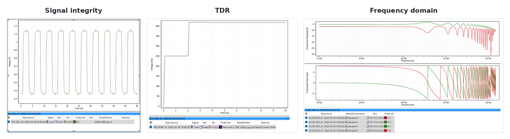
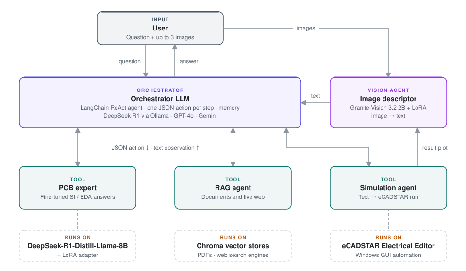
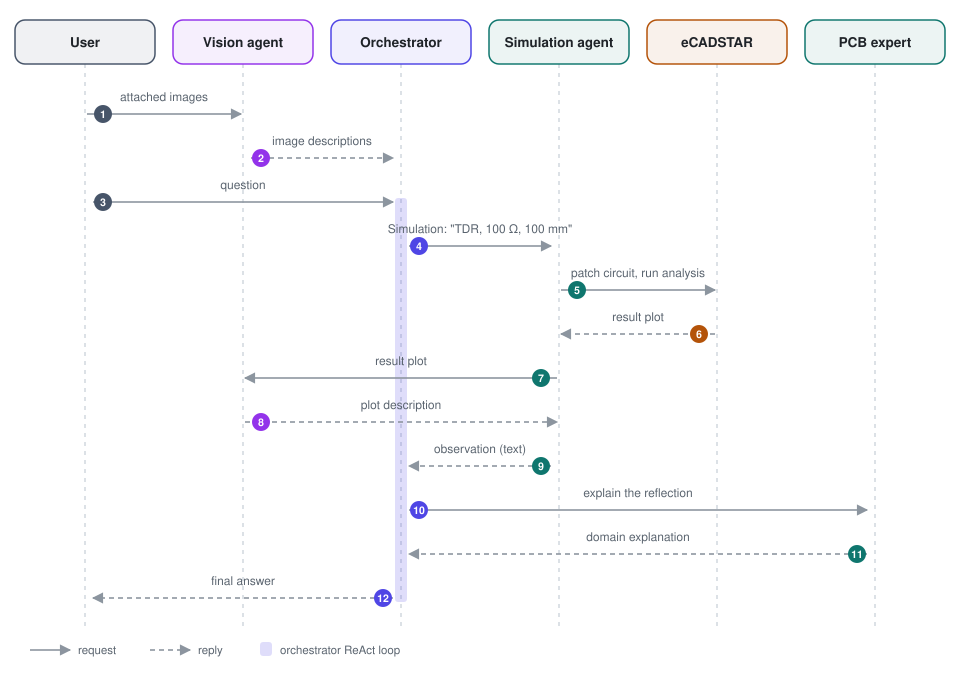
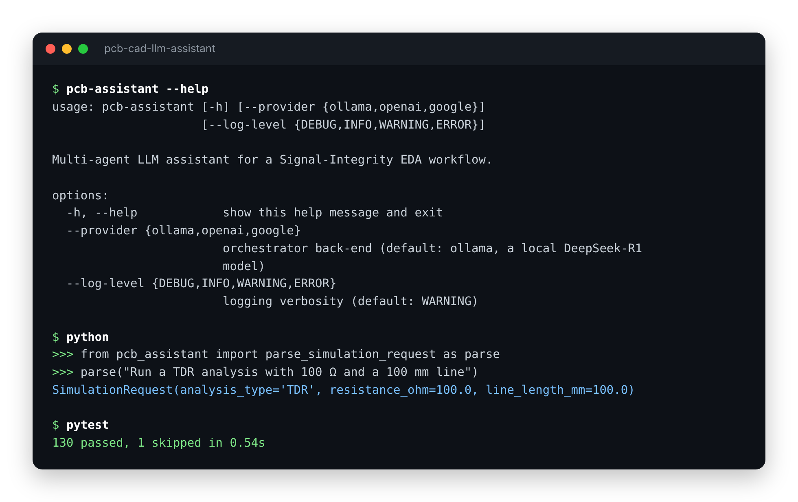
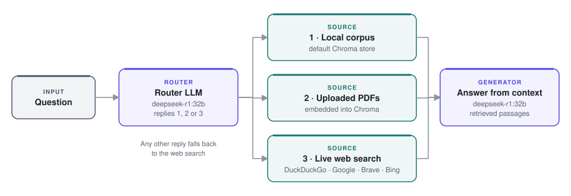
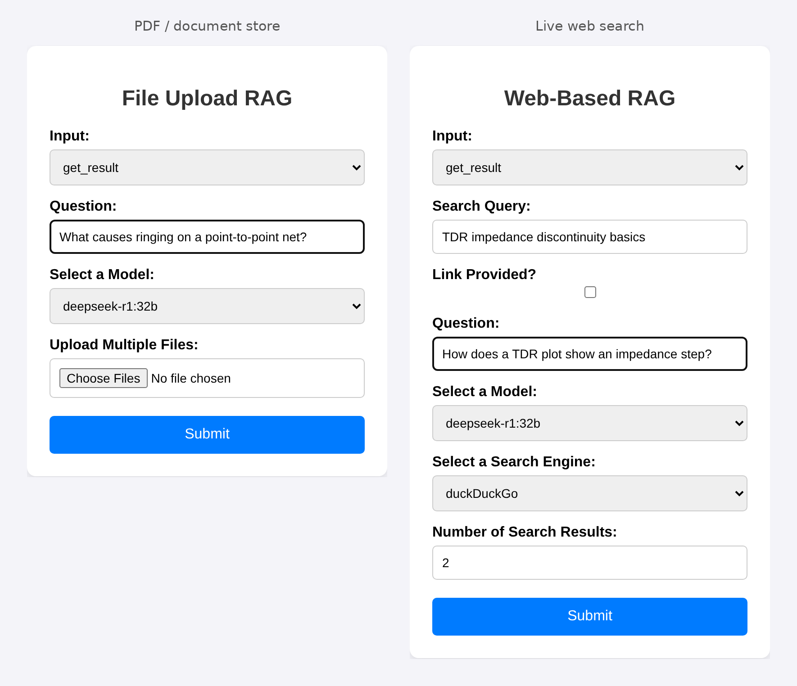
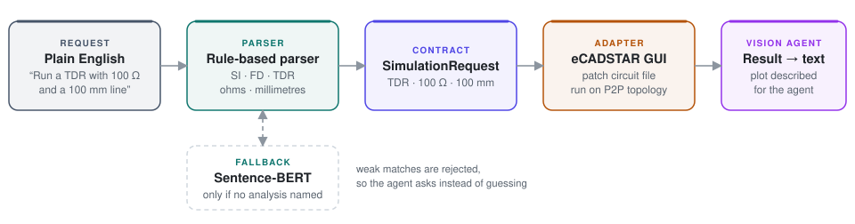

<div align="center">

# PCB CAD LLM Assistant

**A multi-agent, multimodal LLM assistant for Signal-Integrity PCB design in eCADSTAR**

*Answers domain questions, runs live CAD simulations from plain English, and reads circuit and
result images, so that beginners can learn and operate a Signal-Integrity EDA workflow.*

[](https://github.com/kovarthanmuthusamy/pcb-cad-llm-assistant/actions/workflows/ci.yml)


[](LICENSE)

[Overview](#overview) · [Architecture](#architecture) · [Quick start](#quick-start) ·
[Components](#components) · [Project structure](#project-structure) · [Evidence](#verification-and-evidence)

</div>

<p align="center">
  
</p>
<p align="center"><sub>SI, TDR and frequency-domain results produced by eCADSTAR runs that the simulation agent drove.</sub></p>

---

## Overview

EDA tools such as **eCADSTAR** are powerful but hard to learn: a newcomer has to understand
Signal-Integrity (SI) theory, the CAD interface and how to read simulation results all at once. This
project puts an **orchestrator LLM** in front of four specialised tools:

| | Tool | What it does |
| --- | --- | --- |
| 📘 | **PCB expert** | DeepSeek-R1-Distill-Llama-8B with a LoRA adapter fine-tuned on SI/EDA question–answer pairs |
| 🔎 | **RAG agent** | Routes a question to a local corpus, uploaded PDFs or a live web search, then answers from the retrieved text (Chroma) |
| ⚙️ | **Simulation agent** | Turns *"run a TDR with 100 Ω and a 100 mm line"* into parameters and drives the eCADSTAR Electrical Editor |
| 🖼️ | **Vision agent** | A fine-tuned Granite-Vision VLM that turns circuit screenshots and result plots into text |

Highlights:

- **Model-agnostic orchestrator.** Local DeepSeek-R1 through Ollama, OpenAI GPT-4o or Google Gemini,
  selected with `--provider`.
- **Multimodal.** Up to three images per question, and simulation plots are described back to the
  agent as text.
- **Engineering hygiene.** One installable package, all settings in environment variables, heavy
  libraries loaded lazily, 130 unit tests that need no model, GPU or CAD licence, and Ruff, mypy,
  pytest and a Docker build in CI.

> **Context.** Group research project, built with the reasoning and vision-language models available
> in 2023–2024 that were strong at both agentic tool use and image understanding.

### Contribution and ownership

**Kovarthanam Muthusamy** designed the LangChain/ReAct orchestration, fine-tuned the PCB-expert LoRA
adapter, implemented the RAG sub-agent, connected the natural-language parameter extractor to the
eCADSTAR automation, built the FastAPI backend behind the team's user interface, and integrated the
components into the assistant workflow.

The **vision component**, including the fine-tuning of the vision-language model and the VLM
experiments in [`research/vlm/`](research/vlm), was developed by a project colleague and is
integrated here. It is not presented as an individually authored model. Colleagues also built a
React interface intended for use alongside the eCADSTAR PCB editor. The FastAPI backend and that
interface are not part of this public showcase.

Private corpora, model adapters, checkpoints, Chroma databases and raw eCADSTAR project and result
files are deliberately excluded.

---

## Architecture

<p align="center">
<picture>
  <source media="(prefers-color-scheme: dark)" srcset="docs/images/diagrams/architecture-dark.svg">
  
</picture>
</p>

The orchestrator runs a **ReAct** loop (reason → act → observe) and emits one structured JSON
`{action, action_input}` per step (LangChain `STRUCTURED_CHAT_ZERO_SHOT_REACT_DESCRIPTION`), with
`ConversationBufferMemory` for short-term context. Every tool returns **text**, so visual results
are passed through the vision agent first and the whole pipeline reasons in one textual space.

### How one request flows

An example request with an attached circuit image that needs a simulation and a follow-up
explanation:

<p align="center">
<picture>
  <source media="(prefers-color-scheme: dark)" srcset="docs/images/diagrams/query-lifecycle-dark.svg">
  
</picture>
</p>

---

## Quick start

<p align="center">
  
</p>

### With Docker (Ollama included)

```bash
cp .env.example .env                                   # optional: API keys, model names
docker compose up -d ollama
docker compose exec ollama ollama pull deepseek-r1:32b
docker compose exec ollama ollama pull nomic-embed-text
PCB_ORCHESTRATOR_MODEL=deepseek-r1:32b docker compose run --rm assistant
docker compose up webui                                # RAG web UI on http://127.0.0.1:5000
```

The image uses CPU PyTorch by default. For a GPU build, pass
`--build-arg TORCH_INDEX_URL=https://download.pytorch.org/whl/cu124` and enable the GPU block in
[`docker-compose.yml`](docker-compose.yml). The simulation tool needs Windows with eCADSTAR, so in a
container it replies with an error message instead of running a simulation; the other tools work.

### Local install

```bash
python -m venv .venv && source .venv/bin/activate
pip install -r requirements.txt        # models, RAG, Windows GUI adapter
pip install -e .                       # the pcb_assistant package and the pcb-assistant command
cp .env.example .env                   # then fill in your keys

ollama pull deepseek-r1:70b            # default orchestrator (deepseek-r1:32b is lighter)
ollama pull deepseek-r1:32b            # RAG generator and router
ollama pull nomic-embed-text           # embeddings for the document store

pcb-assistant --provider ollama        # or: openai, google; add --log-level INFO to see routing
```

At the prompt, type a question and optionally give up to **3 image paths**. Simulation images are
saved under `simulation_images/` (`ECADSTAR_OUTPUT_DIR`); RAG stores and document folders live under
`rag_data/` (`PCB_RAG_HOME`).

| Command | Default model | Provider |
| --- | --- | --- |
| `pcb-assistant --provider ollama` | `deepseek-r1:70b` | **Local** via Ollama |
| `pcb-assistant --provider openai` | `gpt-4o` | OpenAI |
| `pcb-assistant --provider google` | `gemini-1.5-pro` (check that it is still served) | Google |

Every model name, path and timing is an environment variable; see [`.env.example`](.env.example) and
[`config.py`](src/pcb_assistant/config.py).

### Checks only (no model, GPU, credentials, Windows or eCADSTAR)

```bash
pip install -e ".[dev]"
ruff check . && mypy && pytest
# or, in a container exactly as CI runs it:
docker build --target test -t pcb-assistant:test . && docker run --rm pcb-assistant:test
```

---

## Components

### Orchestrator

One agent, one tool set and one prompt. The small differences between providers (iteration limit,
one extra prompt sentence, whether the last message is repeated in the input) are explicit profiles
in [`llm.py`](src/pcb_assistant/llm.py). Tools are LangChain `StructuredTool`s with Pydantic input
schemas ([`tools.py`](src/pcb_assistant/tools.py)). Models send tool input in several shapes;
`unwrap_tool_input` normalises them and the tools reuse the tested parsing in
[`contracts.py`](src/pcb_assistant/contracts.py). A system instruction keeps the agent to one action
at a time, and post-processing removes `<think>` traces and trailing JSON before display.

### PCB expert

[`experts/pcb_expert.py`](src/pcb_assistant/experts/pcb_expert.py): **DeepSeek-R1-Distill-Llama-8B**
with a **LoRA adapter** fine-tuned on question–answer pairs from the Signal-Integrity area of EDA.
It answers PCB design, manufacturing and noise questions and is the first tool for any PCB query.
The model is loaded on first use and then kept in memory. A Llama-3-8B + LoRA variant was also
trained (see [docs/EVALUATION.md](docs/EVALUATION.md)); only the DeepSeek-based expert is wired in.

### RAG agent

[`rag/`](src/pcb_assistant/rag): an LLM router looks at the available corpora and the question and
picks a source.

<p align="center">
<picture>
  <source media="(prefers-color-scheme: dark)" srcset="docs/images/diagrams/rag-agent-dark.svg">
  
</picture>
</p>

Passages are embedded into **Chroma** and `deepseek-r1:32b` answers from the retrieved context. The
router accepts only 1, 2 or 3 and falls back to the web for anything else. A small local Flask UI
manages uploads and queries:

<p align="center">
  
</p>

```bash
python -m pcb_assistant.rag.webui.app      # http://127.0.0.1:5000 and /web
```

It has no authentication and is meant for local use only.

### Simulation agent

<p align="center">
<picture>
  <source media="(prefers-color-scheme: dark)" srcset="docs/images/diagrams/simulation-agent-dark.svg">
  
</picture>
</p>

- **Parameter extraction** ([`simulation/request.py`](src/pcb_assistant/simulation/request.py),
  `contracts.py`): SI, FD (frequency domain) or TDR (time-domain reflectometry), the resistor value
  (Ω) and the line length (mm) are parsed deterministically. Only when no analysis is named does a
  Sentence-BERT model (`all-MiniLM-L6-v2`) suggest one, and a weak match is rejected so the agent asks
  instead of guessing.
- **Execution** ([`simulation/ecadstar.py`](src/pcb_assistant/simulation/ecadstar.py)): patches the
  circuit file and drives the eCADSTAR Electrical Editor on the default **P2P** topology, then
  captures the result image. The GUI waits are configurable (`ECADSTAR_OPEN_WAIT_S`,
  `ECADSTAR_RUN_WAIT_S`).
- The image is described by the vision agent and returned to the orchestrator as text.

<p align="center">
  
</p>
<p align="center"><sub>Default P2P topology. The agent sets the series resistor (R2) and the line length (TL1) from the request.</sub></p>

### Vision agent

[`vision/granite.py`](src/pcb_assistant/vision/granite.py): a fine-tuned **IBM Granite-Vision-3.2-2B**
(4-bit NF4, LoRA adapter set with `PCB_VISION_ADAPTER_PATH`) prompted to describe circuit topologies
and simulation plots. It describes the user's images at input and the simulation output images. The
fine-tuning and the compared alternatives (LLaVA-1.6-Mistral, Qwen2.5-VL-7B, SmolVLM-500M) are a
project colleague's work, kept unchanged in [`research/vlm/`](research/vlm).

---

## Project structure

```text
pcb-cad-llm-assistant/
├── src/pcb_assistant/
│   ├── cli.py                  command line and chat loop  (pcb-assistant, python -m pcb_assistant)
│   ├── agent.py                ReAct agent: tools, memory, system instruction
│   ├── llm.py                  orchestrator back-ends (ollama / openai / google profiles)
│   ├── tools.py                simulation, PCB expert and RAG tools
│   ├── config.py               all settings, read from the environment / .env
│   ├── contracts.py            model-free tool-input contracts
│   ├── simulation/             request parsing, S-BERT fallback, eCADSTAR GUI adapter
│   ├── experts/pcb_expert.py   fine-tuned SI/EDA expert (DeepSeek-R1-8B + LoRA)
│   ├── vision/granite.py       image → text (Granite-Vision)
│   └── rag/                    router, document and web retrieval, search back-ends, web UI
├── tests/                      130 unit tests with fakes
├── research/vlm/               VLM fine-tuning notebooks and alternative back-ends (colleague)
├── hf_ollama/hf_join.py        merge a LoRA adapter for Ollama export
├── docs/                       evaluation notes, images, diagrams/generate.py (README diagrams)
├── Dockerfile                  targets: test (CI checks) and runtime (the assistant)
├── docker-compose.yml          Ollama + assistant + RAG web UI
├── .github/workflows/ci.yml    Ruff, mypy, pytest and the Docker test image
├── pyproject.toml              package, Ruff, mypy and pytest configuration
├── requirements.txt            runtime dependencies (models, RAG, Windows GUI adapter)
├── .env.example                every setting, with defaults
├── SECURITY.md
└── LICENSE
```

---

## Security

- **No secrets in source.** API keys (OpenAI, Google, Hugging Face) come from environment variables
  or a gitignored `.env`; `.env.example` is the template. If you forked an earlier version that
  contained hard-coded keys, rotate them.
- Raw CAD projects, simulation databases, document corpora and model weights are excluded until
  ownership and redistribution rights are confirmed.
- The RAG web UI has no authentication and runs with Flask debug off unless `PCB_UI_DEBUG=1`.
  Docker Compose publishes it on `127.0.0.1` only. Do not expose it to a network.

See [SECURITY.md](SECURITY.md).

---

## Limitations and future work

- **Platform coupling.** The simulation agent depends on GUI automation of a Windows CAD install
  with fixed waits; a scripting API would make it robust and portable.
- **No end-to-end test in CI.** The tests use fakes for the models, search engines and eCADSTAR;
  the full pipeline has only been run by hand on the development machines.
- **Two-hop vision.** Visual results are flattened to text before reasoning; a natively multimodal
  orchestrator would keep more detail.
- **Single topology.** Simulation targets the default P2P topology.
- **Agent framework.** Built on LangChain's classic agent; a graph-based controller (e.g. LangGraph)
  would give clearer multi-step control and error recovery.

---

## Verification and evidence

| Capability | Public evidence | Current validation boundary |
| --- | --- | --- |
| Tool orchestration | One ReAct agent with Ollama, GPT-4o and Gemini profiles and Pydantic tool schemas; input unwrapping, chat loop and agent wiring unit-tested with fakes | Provider calls need the user's credentials and model access |
| Retrieval | Local / PDF / web routing (router parsing and pipeline dispatch unit-tested) and Chroma indexing and query code | No public retrieval-relevance benchmark is claimed |
| Domain adaptation | DeepSeek-R1-Distill-Llama-8B and Llama-3-8B LoRA integration | Three-epoch training runs exist locally; loss alone is not task-quality evidence |
| CAD automation | Sentence-BERT analysis selection, parameter extraction and the Windows GUI adapter | 78 simulation databases and 78 logs were generated locally but are not published |
| Packaging | Ruff, mypy and pytest on every push; the Docker test image is built and run in CI | The runtime image and Compose stack have not been run end to end in CI |

See [docs/EVALUATION.md](docs/EVALUATION.md) for the implemented evidence, the missing task-level
metrics and the benchmark needed before claiming end-to-end accuracy.

---

## License

[MIT](LICENSE). The base models (DeepSeek-R1-Distill, Granite-Vision, Sentence-BERT) keep their own
licences.

<div align="center">
<sub>Multi-agent LLM assistant for Signal-Integrity EDA · research prototype</sub>
</div>
